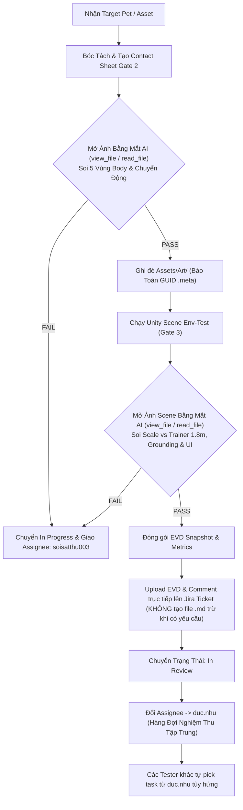

# /evd-test — Quy Trình Kiểm Thử Bằng Chứng Trực Quan & Môi Trường Game (EVD-Test)

Kỹ năng này chịu trách nhiệm thẩm định trực quan, sinh tài liệu bằng chứng (Visual Evidence - EVD), kiểm thử trong môi trường Unity Scene (Scene Env-Test) và điều phối phân công trách nhiệm trên Jira Atlassian cho dự án **Tiến Hóa Tối Thượng (Pokemon Battle)**.

---

## 1. Tôn Chỉ Thiết Quân Luật

1. **"Code Xanh Không Có Nghĩa Là Game Chơi Được Bằng Mắt"** (Green Tests != Visual Sanity):
   - Không chấp nhận nghiệm thu chỉ dựa vào kết quả Unit Test C# headless.
   - Mọi asset (Sprite nhân vật, Hoạt cảnh chiêu thức, VFX, Vật phẩm, Địa hình) bắt buộc phải qua 2 cổng bằng chứng độc lập: **Gate 2 Dark Checkerboard** và **Gate 3 Scene Env-Test**.
2. **Quy Định 2 Cổng Bằng Chứng EVD & Thiết Quân Luật Cấm Ảnh Lưới Nhiều Ô Con (/learn Zero-Contact-Sheet Law)**:
   - **Tuyệt Đối Cấm Ảnh Ghép Nhiều Ô Con / Contact Sheet / Sprite Grid**:
     - **CẤM TUYỆT ĐỐI**: Tống cả ma trận ảnh hàng chục row/col gồm nhiều frame/nhiều action li ti vào 1 bức ảnh EVD.
     - **CHUẨN NGHIỆM THU ẢNH TĨNH**: Mọi bằng chứng ảnh tĩnh bắt buộc là **ảnh chụp đơn trực tiếp từ màn chơi thật (In-Engine Scene PlayMode Screenshot 16:9 / 1080p)** đặt nhân vật/Linh thú trong map game thật cạnh Trainer và quái, hoặc **1 ảnh đơn tỷ lệ 1:1 rõ nét của một khung hình duy nhất**.
     - **CHUẨN NGHIỆM THU CHUYỂN ĐỘNG**: Mọi chuyển động bắt buộc kiểm thử bằng **Animated GIF looping (chu kỳ 2–3s, 12–15 FPS, < 5–8MB)** ghi lại trực tiếp chu kỳ chuyển động thực tế trong PlayMode.
   - **Gate 2: High-Contrast Defect Inspection (Ảnh đơn 1:1 & Motion GIF)**:
     - Nền tối bàn cờ (`#121820` / `#0a0e14`) hoặc nền tương phản cao.
     - Đường kẻ sàn xanh cố định chuẩn Paw-Locking (`#00FF78`).
     - Khử sạch 100% mảng trắng canvas kẹt trong thân/đuôi/tai/nách; pixel trắng còn lại $\le 200\text{px}$ (chỉ dành cho đốm sáng nhãn cầu hoặc răng).
     - Tỷ lệ giải phẫu 1:1, Safe Margin Buffer $\ge 120\text{px}$, 0 rác rìa văng, 0 mép cắt phẳng.
   - **Gate 3: Scene Env-Test trong Unity**:
     - Đặt asset vào Scene game thật (`Map01_BachMocSon.unity`, `Map03_PhongNhaGrotto.unity`...) ngay cạnh Trainer ($1.8\text{m}$).
     - Đo đạc tỷ lệ thế giới thực (In-Game World Scale): Pet S1 ($0.75\text{m} - 1.0\text{m}$), Pet S2 ($1.2\text{m} - 1.5\text{m}$), Pet S3 ($1.8\text{m} - 2.4\text{m}$), Vật phẩm ($0.35\text{m} - 0.50\text{m}$).
     - **Chuẩn Motion GIF PlayMode**: Đối với các asset động (VFX chiêu thức, hoạt cảnh Pet, tương tác nước wading/ripples/splash), bắt buộc capture chuỗi khung hình PlayMode và xuất thành **Animated GIF Looping (2–3 giây, 12–15 FPS)** đính kèm lên ticket để `duc.nhu` (đầu mối nghiệm thu tập trung) và các tester soi độ nhịp nhàng, tốc độ lan tỏa và bọt văng.
     - Kiểm tra In-Engine Paw-Locking: Chân cắm vững chắc trên mặt đất/địa hình, không lơ lửng, không lún sàn.
     - Kiểm tra tương thích shader (`Sprites/Default`) và hiển thị qua Camera chính.
3. **Luật Phân Quyền Subagent Thực Thi vs Studio PM Nghiệm Thu Bằng Mắt & Điều Hướng Jira Assignee (/learn PM Gatekeeper Law)**:
   - **Cấm Subagent Tự Nghiệm Thu**: Subagent thực thi kỹ thuật chỉ được phép tạo asset, chạy capture và nộp đường dẫn file EVD về cho Studio PM. **Subagent TUYỆT ĐỐI CẤM tự gọi lệnh chuyển trạng thái Jira sang `In Review` hoặc tự gán cho `duc.nhu`**.
   - **Studio PM Độc Quyền Nghiệm Thu Bằng Mắt (`read_file`), Bắt Buộc Soi 100% Từng Ảnh / Từng Frame Đơn Của GIF & Chốt Chặn Tối Đa 3 Lần Review (/learn Mandatory All-Slide & All-Frame Inspection Law)**:
     - Studio PM và Kiểm định viên **BẮT BUỘC mở xem trực tiếp bằng `read_file` 100% tất cả các ảnh trong slide VÀ toàn bộ từng file `.png` đơn lẻ (00, 01, 02, 03...) cấu thành nên ảnh động GIF** (cấm chỉ mở 1 frame đại diện rồi suy diễn cả bộ PASS).
     - Trên từng frame đơn, kiểm tra chặt: đếm đúng 4 chân (cấm dị dạng 5 chân hoặc cụt chân/vạt phẳng ngực), sạch 100% mảng trắng kẹt ở khe hẹp giữa các đuôi/cổ/bụng, không thủng mất lòng trắng mắt/ngực, không cắt cụt mép khung hình, không dính VFX rời trên body, đúng huyết thống tiến hóa từ cấp trước (cấm biến Khủng long thành Rùa), và chân tiếp đất đúng tâm bóng đổ.
     - **Hạn chế bắt lỗi Biểu cảm**: Nếu nhân vật/Linh thú đã có biểu cảm phản xạ rồi thì **THÔI KHÔNG BẮT LỖI BIỂU CẢM NỮA**.
     - **Tối đa 3 lần review**: Mỗi lỗi / mỗi task tuyệt đối KHÔNG trả về quá 3 lần review. Nếu đã qua 3 lượt review mà không còn lỗi hỏng nặng về giao diện/địa hình/âm thanh thì bắt buộc duyệt chuyển `In Review` ngay.
   - **Chưa PASS EVD-Test (`STATUS_NOT_PASSED_EVD`)**:
     - Áp dụng khi: Task mới tạo, đang xử lý, chờ remake ChatGPT, bóc tách lỗi, hoặc bị **Studio PM** soi mắt đánh rớt (`REJECTED BY PM EYE-FIRST AUDIT` / `FAIL`).
     - **Trạng thái & Assignee**: Trả về **`In Progress`** và gán ngay cho **`soisatthu003`** (`Developer` — Account ID: `712020:c9528815-26ee-4d9d-9950-6ff9eca9eac7`) kèm comment chỉ rõ từng lỗi thị giác, đồng thời giao Subagent sửa lại tận gốc.
   - **Đã PASS EVD-Test (`STATUS_PASSED_EVD` — Chỉ do Studio PM ký duyệt)**:
     - Áp dụng khi: Có đủ **CẢ 2 CỔNG BẰNG CHỨNG** (Contact Sheet Dark Checkerboard + Scene Env-Test cạnh Trainer + Looping Motion GIF) và đã được **Studio PM trực tiếp mở xem bằng `read_file` xác nhận ĐẸP 10/10**.
     - **Chuyển trạng thái**: Studio PM chuyển ticket sang **`In Review`**.
     - **Tải đính kèm & Tự Động Xóa File Local**: Upload toàn bộ ảnh PNG & GIF EVD lên Jira ticket qua REST API (`tools/jira_task.py attach`). Ngay sau khi upload thành công lên Jira, tự động xóa file bằng chứng trên máy local để giải phóng dung lượng đĩa, không lưu cữu rác evidence.
     - **Assignee (Hàng Đợi Nghiệm Thu Duy Nhất)**: Bắt buộc chuyển ngay sang **`duc.nhu`** (`Nhữ Hoàng Minh Đức` — Account ID: `712020:57c682e4-9751-4e74-bc50-32227ebf4b38`).
     - **Cơ Chế Tester Tự Pick Việc**: `duc.nhu` là đầu mối/hàng đợi nghiệm thu tập trung duy nhất của Studio. Mọi tester khác trong team chủ động truy cập danh sách task của `duc.nhu` để tự lấy/nhận task theo nhu cầu/tùy hứng để kiểm thử PlayMode và đóng task (`Done`). Cấm AI tự ý gán task phân tán cho tester khác.

---

## 2. Quy Trình Thực Thi Chi Tiết (Step-by-Step Flow)



### Bước 1: Tạo & Kiểm Định EVD Gate 2 Bằng Mắt AI (`view_file` / `read_file`)
- Sinh ảnh Contact Sheet ghép các frame trên nền Dark Checkerboard kèm thanh kẻ sàn xanh.
- **Thiết Quân Luật Zero Markdown EVD**: Tuyệt đối KHÔNG tự ý tạo file `.md` mô tả hay report EVD trong repo/artifact trừ khi người dùng yêu cầu trực tiếp. Mọi mô tả, kết quả Gate 2/Gate 3 và số liệu quota được comment trực tiếp lên Jira ticket.
- **CẤM TUYỆT ĐỐI dùng bất kỳ script Python nào để chấm điểm hình ảnh, đo tỷ lệ giải phẫu, đếm pixel hay tự động phán quyết `PASS`**.
- AI bắt buộc dùng `view_file` / `read_file` mở từng bức ảnh Contact Sheet và ảnh Scene ra nhìn trực tiếp bằng mắt như người thật chơi game, tự mô tả những chỗ chưa ổn:
  1. Đồng nhất Stage, giống loài, tỷ lệ đầu/thân và thần thái giữa các động tác (không bị đơ như Idle, không copy-paste trùng lặp pose giữa các chiêu, thứ tự frame hợp lý, không bị cắt mất đầu/thân/đuôi).
  2. Khử sạch mảng trắng canvas kẹt nền (đặc biệt là hốc trắng dưới gầm bụng giữa chân trước và chân sau ở các nhịp chạy/nhảy), bảo toàn 100% độ đục vùng lông/mang/mắt trắng nội tại (cấm để mất nền/thủng trong suốt), và sạch 100% viền hạt trắng răng cưa (white halo/fringe).
  3. Kiểm tra giải phẫu từng frame (đếm đúng 4 chân, cấm mọc thừa chân thứ 5; đuôi phải có chuyển động vẫy thứ cấp không đóng băng tĩnh) và đồng bộ tỷ lệ hộp sọ/lồng ngực giữa Idle – Run – Jump (cấm cân bằng theo tổng diện tích pixel khiến đầu/thân bị teo nhỏ khi chạy).
  4. Cắm sàn Paw-Locking cố định Y đối với Pet bộ binh; bay lơ lửng vỗ cánh đối với Pet hệ bay.
  5. Tỷ lệ trong Scene đặt cạnh Trainer $1.8\text{m}$ vừa vặn, không bị cỏ/địa hình che mặt, không hỏng/mất texture nền đất hoặc mất nền background.

### Bước 2: Tích Hợp An Toàn Vào Unity
- Copy các frame sprite sạch vào `Assets/Art/Pokemons/<Pet>/<Action>/`.
- **BẮT BUỘC BẢO TOÀN NGUYÊN VẸN FILE `.meta`** để không làm hỏng GUID reference của Animation Clips và Prefabs.

### Bước 3: Chạy Scene Env-Test (Gate 3)
- Kích hoạt Unity chạy batchmode capture phương thức tương ứng (ví dụ: `MatVuSceneEvidenceCapture.CaptureAll` hoặc `VisualScaleEyeTestCapture.Capture`):
  ```bash
  /Applications/Unity/Hub/Editor/6000.6.0f1/Unity.app/Contents/MacOS/Unity \
    -batchmode -nographics -quit \
    -projectPath /Users/duc/my-projects/pokemon-combat \
    -executeMethod PokemonBattle.Editor.<CaptureClass>.CaptureAll \
    -logFile production/qa/evidence/<logfile>.log
  ```
- Kiểm tra ảnh chụp scene view xuất ra trong `production/qa/evidence/`.

### Bước 4: Đồng Bộ Jira, Truy Vết Token/Quota & Điều Hướng Assignee
- Sử dụng Jira REST API và [`tools/trace_and_sync_jira_task_tokens.py`](../../../tools/trace_and_sync_jira_task_tokens.py) để:
  1. Tải các file ảnh EVD lên ticket đính kèm (Attachments).
  2. Đăng comment bảng chẩn đoán định dạng ADF table.
  3. **Bắt buộc truy vết & đăng bảng AI Token & Quota Consumption**: Đọc `.system_generated/logs/transcript_full.jsonl` của phiên thực thi + các Subagent, tính toán `Direct Executor I/O`, `Shared PM/QA I/O`, `Input Tokens`, `Output Tokens`, `Active I/O Tokens`, `Cache Read Tokens`, `Grand Total Context` và `% Quota` (`agy-cli-manager refresh-usage`), đăng trực tiếp lên ticket Jira.
  4. Nếu **PASS**: Transition sang `In Review` (ID: `41`) và gán trực tiếp cho `duc.nhu` (`712020:57c682e4-9751-4e74-bc50-32227ebf4b38`) làm hàng đợi nghiệm thu tập trung duy nhất (các tester khác tự pick việc từ đây).
  5. Nếu **FAIL**: Gán cho `soisatthu003` (`712020:c9528815-26ee-4d9d-9950-6ff9eca9eac7`) kèm lỗi chi tiết.


---

## 3. Gate và Bàn Giao Bước Tiếp Theo (Handoff & Verification Gate)

### Quy định quyền ghi và phê duyệt (Approval-before-write contract)
- Trước mutation, phải trình bày rõ ràng exact paths và kiểm tra phạm vi phê duyệt (approval) của task hiện tại.
- Quyền ghi chỉ bao phủ đúng scope đã được phê duyệt (approval-before-write); nếu thiếu phê duyệt hoặc mở rộng phạm vi ngoài scope thì phải dừng lại xin ý kiến người dùng.

### Đánh giá Gate và Handoff
- Mọi kết quả nghiệm thu phải được kết luận với verdict rõ ràng:
  - `PASS`: Toàn bộ tiêu chí đạt 10/10 và các bài test xanh.
  - `CONCERNS`: Còn tồn tại điểm cần theo dõi thêm.
  - `FAIL`: Phát hiện lỗi nghiêm trọng chưa khắc phục được.
  - `BLOCKED`: Bị chặn bởi dependency hoặc thiếu công cụ.
  - `NOT RUN`: Các bước kiểm thử chưa được thực thi.
- Kết thúc bằng handoff cho PM với đúng một hành động tiếp theo (next step) cụ thể, ghi nhận trạng thái vào `production/session-state/active.md`.
